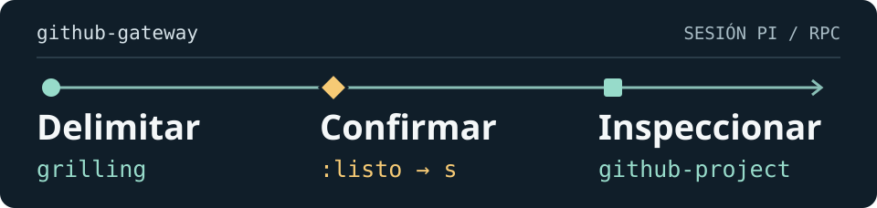
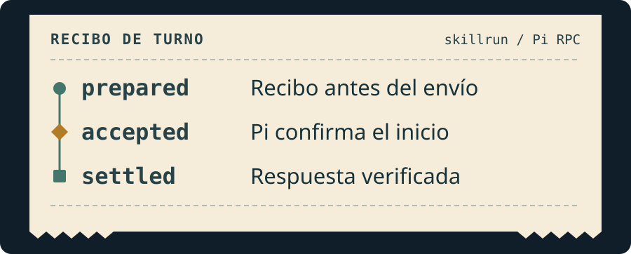

# skillrun


Una CLI para ejecutar skills de Pi en orden. Primero defines el objetivo con el agente;
solo cuando confirmas su síntesis pasa a la siguiente skill. Si un envío se interrumpe
y no se sabe si Pi lo recibió, `skillrun` se detiene en lugar de repetirlo.


**Fase 6 integrada en `main`.** [Primer uso](#primer-uso) · [Cómo funciona](#cómo-funciona) · [CLI](#cli) · [Prueba real](#prueba-real-fase-6)

## Primer uso

Desde la raíz del repositorio, con Python 3.12 o posterior y `uv`:

```bash
make install
uv run skillrun validate plugins/github-gateway/plugin.json
```

Esto **no inicia Pi**. Comprueba el esquema del plugin y el formato de sus pins
(las huellas que identifican cada versión de las skills). La salida estándar es una línea JSON:

```json
{"ok": true, "plugin_id": "github-gateway", "digest": "6c13251d4e8775c2df6cbf4bfd7da1bc2ecff1956fa978412047f31574701501"}
```

Para ejecutar el flujo necesitas Pi en el `PATH` y un proveedor configurado.
Este ejemplo inspecciona el checkout actual: no lo edites mientras el agente trabaja.

```bash
uv run skillrun run plugins/github-gateway/plugin.json \
  --goal "Identificar cómo se prueba este repositorio" \
  --cwd . --run-id diagnostico-01
```

Responde al agente por la terminal. Una respuesta como `/skill:grilling ejemplo`
queda como texto literal en el historial de Pi; no invoca la skill. Escribe
`:listo` para pedir la síntesis: `s` la confirma y `n` vuelve a las preguntas.

## Cómo funciona



El [plugin de ejemplo](plugins/github-gateway/plugin.json) empieza con `grilling`.
Tras tu confirmación, `github-project` inspecciona el checkout y devuelve un
diagnóstico con referencias a archivos. Trabaja en la misma sesión de Pi con
`read`, `grep`, `find` y `ls`: no necesita `gh` ni escribe en GitHub.
El host le indica cómo consultar los archivos sin delegar en subagentes, en
lugar de cargar un `APPEND_SYSTEM.md` del proyecto o del usuario.

## CLI


| Comando | Cuándo usarlo |
| --- | --- |
| `validate` | Antes de ejecutar: comprueba el esquema del plugin sin leer los archivos de las skills. |
| `run` | Inicia o retoma la ejecución. Verifica las copias de las skills contra sus pins antes de usarlas. |
| `status` | Consulta el último checkpoint sin iniciar Pi ni modificar el estado. |
| `reconcile` | Decide qué hacer con un turno cuya entrega es incierta. No reenvía el prompt. |

`run`, `status` y `reconcile` devuelven una línea JSON en stdout con
`run_id`, `status`, `exit_code`, `step_id` y `reason`. Las preguntas y los avisos
van a stderr. Al completar el flujo, `result` contiene el último bloque JSON del paso
final, validado contra el contrato y el recibo. Se rechazan los números no finitos,
también dentro de objetos y listas. Repetir un run completo con los mismos
parámetros verifica el resultado guardado sin iniciar Pi.

### Consultar y recuperar una ejecución



El recibo distingue **preparar un envío**, **recibir el acuse de Pi** y
**verificar la respuesta** en el historial. Para consultar el último estado:

```bash
uv run skillrun status --run-id diagnostico-01
```

Si el recibo legible indica `prepared` o `accepted` tras una caída, repite el
comando `run` original: el motor clasifica el turno sin reenviarlo. Si el estado
indica `reconcilable: true`, usa:

```bash
uv run skillrun reconcile --run-id diagnostico-01
```

`reintentar` habilita otro intento; **solo un nuevo `run` lo envía**.
`abandonar` cancela la ejecución. Si el recibo cambia mientras decides, o si
interrumpes la consulta sin responder, no se registra la decisión.
`status` informa el estado persistido; no verifica por sí solo la traza final.

| Salida | Significado |
| --- | --- |
| `0` | Plugin válido o ejecución completa |
| `2` | Error de uso |
| `3` | Checkpoint pendiente, reintento habilitado o lock ocupado |
| `10` | Plugin inválido, ejecución bloqueada o estado no disponible |
| `70` | Error interno |
| `130` | Interrupción, fin de entrada sin decisión o abandono |

El estado y la sesión de Pi se guardan **fuera de `--cwd` y del checkout que lo
contiene**: en `$XDG_STATE_HOME/skillrun/<id>/` si `XDG_STATE_HOME` es absoluto,
o en `~/.local/state/skillrun/<id>/`. El ID público debe cumplir
`[a-z0-9][a-z0-9-]{0,63}`; incluso con un guion final, usa el mismo ID en la CLI.
Consulta la [guía operativa](docs/agent/RUNTIME.md) para los permisos y la
recuperación manual de historiales antiguos.

## Prueba real (Fase 6)

En la prueba con **Pi 1.6.0 y un proveedor real**, el plugin completó los pasos
`discovery` y `github-knowledge` sobre un clon local. El
[handoff de Fase 6](handoffs/HANDOFF-2026-11-21-PHASE-6.md) registra tanto el
resultado con ocho referencias como el primer intento, que terminó con la lista
de evidencia vacía. Un código de salida `0` no certifica la calidad del diagnóstico.

Las correcciones finales del [PR #3](https://github.com/fegome90-cmd/skill-loop/pull/3)
se comprobaron por separado. La [guía de verificación](docs/agent/RUNTIME.md#evidencia-y-pendientes)
distingue las pruebas locales, el ensayo offline con Pi y los checks de GitHub.

## Calidad

```bash
make lint
uv run pytest
```

El runtime usa solo la biblioteca estándar de Python. El [mapa del código](docs/agent/CODEMAP.md)
ubica el motor, los plugins y las pruebas. El [plan](PLAN.md#6-fases) registra las fases
entregadas y el alcance pendiente; [AGENTS.md](AGENTS.md) orienta el trabajo por fase.

## Colaboración

Los cambios a `main` entran por pull request con el check obligatorio
`Secrets and private paths`. Consulta la [plantilla de PR](.github/PULL_REQUEST_TEMPLATE.md)
y las [instrucciones de seguridad](SECURITY.md) antes de publicar.
Para comprobar los archivos preparados, ejecuta `./scripts/check-secrets.sh staged`
con [Gitleaks 8.30.1](https://github.com/gitleaks/gitleaks/releases/tag/v8.30.1).

[Constitución del proyecto y procedencia](docs/CONSTITUTION.md) · [Licencia MIT](LICENSE)
